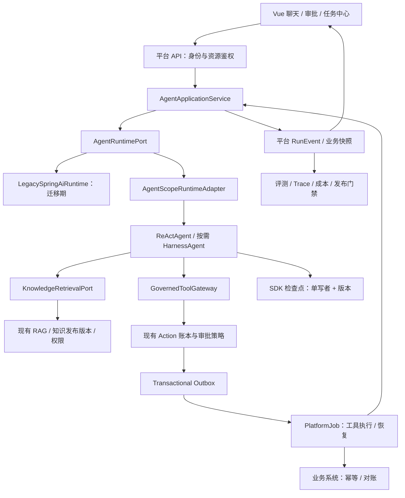
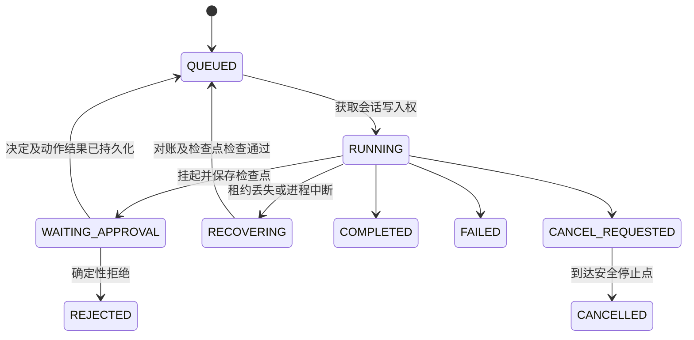

# AgentScope 2.x 架构升级与系统完善方案

> 编制日期：2026-11-03。状态：架构方案，SDK 与部分可靠执行已实现；当前进度见 [V31](agentscope-runtime-implementation.md) 与 [V32](reliable-agent-action-runtime.md)，完整方案仍分阶段推进。
> 基线：当前工作区（包含已有未提交改动），不是已部署环境的核验结果。
> 方法：ub-mode——先形成最小可验证闭环，再收敛架构，最后建立质量门禁。

## 1. 建议决策

**保留模块化单体和现有知识平台，以 AgentScope Java 2.x 逐步替换自建 Agent 推理循环。第一阶段采用 ReActAgent；有明确文件工作区、长任务或子 Agent 需求时，再启用 HarnessAgent。**

当前系统的优势在于知识治理、混合检索、业务工具审批、任务中心和评测闭环。升级应增强任务执行可靠性，不能把这些业务能力重新交给另一套平台建设。

建议分工：

- **Spring AI**：继续承载现有 RAG、Embedding、文档处理及普通问答链路。
- **AgentScope Java**：承载 Agent 推理、结构化工具调用、类型化事件及运行上下文；通过适配层接入平台。
- **本系统**：拥有用户与资源权限、业务审批、外部动作账本、知识版本、质量门禁、任务调度和业务结果。
- **暂缓引入**：独立 AgentScope Service 控制面、全量微服务化、全功能沙箱、默认多 Agent、第二套长期记忆库。

验收目标不是“成功启动一个 AgentScope Demo”，而是：**查订单 → 检索售后政策 → 提交工单审批 → 执行一次 → 宕机后继续 → 展示证据与业务结果 → 纳入回归评测**。

## 2. 版本事实与适用边界

### 2.1 用户提供的两个链接属于不同 SDK

| 对象 | 本轮核实事实 | 对本系统的意义 |
|---|---|---|
| `docs.agentscope.io/zh/versions/2.0.2` | 其 quickstart 使用 Python 3.11+、`agentscope==2.0.2`、`reply/reply_stream` | 可参考设计理念，不能直接作为 Java API 或 Maven 版本依据 |
| `agentscope-ai/agentscope-java` | 独立 Java 仓库，存在 v2.0.2、v2.0.3 发布标签 | Java 实施必须按该仓库的固定标签核验 |
| Java v2.0.2 | 发布说明主要涉及 AgentFactory、RuntimeContext 传递、远程子 Agent 事件及 TaskStore 解耦 | 这些是 Java 补丁版本增量，不等同于 Python 2.0.2 的完整能力清单 |
| Java v2.0.3 | 包含状态版本与乐观并发原语、SSE 相关能力及多项恢复修复 | 建议作为 PoC 候选版本，验证后锁定 |
| 当前项目 | Java 21、Boot 3.5.2、Spring AI 1.1.2；POM 未声明 AgentScope | 本项目是接入新运行时，不是 AgentScope 1.x 升 2.x |

来源：[Python 快速开始](https://docs.agentscope.io/zh/versions/2.0.2/quickstart)、[Java v2.0.2](https://github.com/agentscope-ai/agentscope-java/releases/tag/v2.0.2)、[Java v2.0.3](https://github.com/agentscope-ai/agentscope-java/releases/tag/v2.0.3)。

**版本策略**：以 Java 2.0.3 进行兼容性验证；不使用 `LATEST`、浮动范围或主分支 SNAPSHOT。这里只确认了可用发布记录，没有完成 Maven 制品下载、编译或兼容性认证，也不宣称 2.0.3 是全部发布渠道的最新版本。

Java 2.0.3 根 POM 的 Java 基线为 17，本项目 Java 21 满足语言版本下限；这不代表 Spring Boot、Jackson、Reactor、模型 SDK 自动兼容。[固定标签 POM](https://raw.githubusercontent.com/agentscope-ai/agentscope-java/v2.0.3/pom.xml)

### 2.2 应采用的新能力

| 能力 | 本系统落点 | 采用时机与限制 |
|---|---|---|
| ReActAgent / HarnessAgent 分层 | 用轻量推理运行时替代 `AgentAskService` 中的循环 | 首期只接 ReActAgent；Harness 按场景增加 |
| 类型化消息与 `streamEvents()` | 真实流式输出、工具卡片、暂停状态 | P1；映射为平台协议，不把 SDK 类型暴露给 Vue |
| Permission / HITL | 从提示词暂停升级为结构化挂起与恢复 | P1；业务审批仍由现有平台裁决 |
| Middleware | 上下文、预算、Trace、输出过滤 | P1；只添加确有边界需求的中间件 |
| AgentStateStore / RuntimeContext | 持久化结构化上下文、区分调用身份 | P1；跨用户隔离仍需平台鉴权 |
| v2.0.3 状态版本机制 | 拒绝过期状态覆盖 | P1；不能替代外部动作幂等及单会话写入协调 |
| 上下文压缩、大工具结果外置 | 减少长对话成本、避免截断破坏消息 | P2；摘要不能代替审批事实和业务账本 |
| Workspace / Sandbox | 报表、文件分析等任务的隔离空间 | P3；普通知识问答不授予宿主机文件或 Shell 权限 |
| 子 Agent、MCP、AG-UI / A2A | 专项任务分工与外部集成 | P3；先证明单 Agent 无法满足质量或延迟目标 |

分层设计与能力来源：[Java 2.0 GA](https://github.com/agentscope-ai/agentscope-java/releases/tag/v2.0.0)。消息语义来源：[Message & Event](https://java.agentscope.io/v2/en/docs/building-blocks/message-and-event)。本表的采用顺序是本项目的架构判断，不是官方推荐路线。

不要把在线文档中的事件数量、Hook 数量当成固定版本契约：Java GA 发布说明与当前在线文档已有差异。实现只依赖固定标签实际存在的类型，并用契约测试保护适配层。

### 2.3 不应照搬的部分

Java 迁移指南把旧 RAG、长期记忆 API 标为弃用并说明正在重构。因此保留 `RagSearchService` 与现有记忆领域，通过工具或上下文适配接入，不围绕旧 `Knowledge/LongTermMemory` API 建设新模块。这里说的是旧 API 的迁移状态，不是断言所有 2.x 知识能力都不可用。[Java 迁移指南](https://java.agentscope.io/v2/en/docs/change-log)

SDK 提供恢复机制不代表业务动作能够“恰好执行一次”；沙箱也不能自动提供业务授权。平台需要独立解决资源权限、审批绑定、幂等和结果对账。

## 3. 当前系统核验与优先修复项

以下结论来自静态代码阅读。确定的实现行为与尚待测试的风险分别标注；未执行生产环境诊断。

### 3.1 已有资产，应继续复用

| 能力 | 代码或文档依据 | 升级处理 |
|---|---|---|
| 混合检索、级联检索、改写、扩展、HyDE | `service/RagSearchService.java`，`service/impl/RagSearchServiceImpl.java` | 保留；提取含鉴权和引用的检索入口 |
| 工具可用性、参数校验、审批、业务结果 | `AgentToolService`、`AgentActionService`、`AgentToolHttpClient` | 保留领域规则；拆开动作登记与动作执行 |
| Run / Step / Action 记录 | `agent/RunStateService.java`、`entity/AgentRun.java` | 保留业务 ID 和历史视图，增加版本与关联信息 |
| DAG 工作流与审批续跑 | `workflow/executor/WorkflowEngine.java` | 保留确定性流程；用节点调用 Agent 运行时 |
| 任务租约、Outbox、索引恢复 | `PlatformJobDispatcher` 及可靠执行相关文档 | 复用；接入 Agent 动作和恢复任务 |
| 五层记忆、反馈改进、评测与发布 | `MemoryOrchestrator`、现有架构及路线图 | 先修隔离与生命周期，再按收益精简 |
| Vue 工具卡片和审批中心 | `api/agentRun.ts`、`AgentToolCard.vue` | 增量更新事件协议和恢复交互 |

Java 代码相对目录统一指 `rag-backend/src/main/java/cn/sdh/backend/`；前端路径相对 `rag-frontend/src/`。工作区已出现 V29/V30 以及对应未提交实现，不能把旧路线图中所有待办重新认定为“尚未开发”；是否合并、部署及验收需另核实。

### 3.2 直接影响升级的发现

| 优先级 | 已观察到的代码事实 | 影响与建议 |
|---|---|---|
| P0 | `RunStateService.persistRounds()` 对 JSON 字符串取尾部；解析异常后 `loadRounds()` 返回空列表 | 超限可能生成非法 JSON并静默丢失上下文。先按完整消息裁剪再序列化；损坏快照应进入可诊断的恢复失败状态 |
| P0 | `AgentActionService.execute()` 在 CAS 后同步调用外部 HTTP，再落执行结果；HTTP 客户端接口未携带动作幂等键 | 外部成功、平台落库前崩溃存在结果不确定窗口。需要下游幂等协议或查询对账，不能简单重试所有失败动作 |
| P0 | `WorkingMemoryLayer` 的 Redis key 只拼接 sessionId；`clearByUserId()` 仅记录警告 | 身份隔离与“清除全部记忆”契约不足。改为用户/租户作用域及用户会话索引；是否可跨用户利用还需入口鉴权测试 |
| P1 | `AgentAskService` 非流式 `model.call()` 后 `emitContent()` 切片 | Agent 模式并非模型 Token 实时流。接入 SDK 事件流，并测量首个可见 Token 延迟 |
| P1 | `__agent_pause__` 返回给模型，等整轮结束才置为等待审批 | 已有执行侧审批闸，但运行控制仍部分依赖模型遵循暂停提示。应在运行时挂起，不能把提示词作为状态机 |
| P1 | `resumeInBackground()` 直接 `subscribe()`；工作流后台续跑使用线程池 | 重启恢复缺少统一持久化调度入口。审批提交后用 Outbox 驱动恢复 Job |
| P1 | `RunStateService.nextSeq()` 使用 `count + 1`；普通 `save()` 全量更新 | 并发事件与多副本将放大序号冲突和陈旧覆盖风险；当前风险尚未并发复现。使用单写者、版本 CAS 与唯一序号 |
| P1 | `MemoryOrchestrator` 用静态 ThreadLocal 保存 episode，另用公共线程池异步提取 | 线程不是会话身份，跨线程不能可靠关联 episode。显式传不可变上下文，以会话键持久化 episode |
| P1 | Token 上限在模型返回后检查；工具循环由模型客户端内部执行 | 应在每次模型调用和工具调用前检查剩余预算，验证 maxSteps 能否限制真实工具链；不能仅依赖外层轮次 |
| P2 | `api/agentRun.ts` 续流没有事件游标；聊天与续流分别解析 SSE | 增加共享解析器、事件 ID、去重及快照回放；断线不等同于任务失败 |

定位示例：[消息快照与序号](../rag-backend/src/main/java/cn/sdh/backend/agent/RunStateService.java)、[Agent 循环](../rag-backend/src/main/java/cn/sdh/backend/agent/AgentAskService.java)、[动作执行](../rag-backend/src/main/java/cn/sdh/backend/service/AgentActionService.java)、[工作记忆](../rag-backend/src/main/java/cn/sdh/backend/memory/layer/WorkingMemoryLayer.java)。

这些问题不必等待 SDK 集成才修复。特别是外部动作幂等、用户隔离和快照有效性，属于两个运行时共同的业务基础。

## 4. 目标架构与职责边界



图中名称是建议的新边界，不表示代码中已经存在这些类。优先在现有 Maven 模块内按包隔离，不为每个接口拆一个服务。

### 4.1 每个决策只有一个负责人

| 决策或数据 | 唯一权威 | 其他组件的角色 |
|---|---|---|
| 工具能否被某用户调用、谁审批 | 平台业务策略与 Action 账本 | SDK 权限适配器消费决策；不能重新维护审批名单 |
| 模型下一步调用什么工具 | 当前 run 绑定的运行时 | DAG 只编排节点，不嵌套另一套模型内部循环 |
| 外部写操作是否发生 | 下游业务回执 + Action 账本 | SDK 消息只是结果引用，不能凭模型文字确认成功 |
| Run 是否可启动或恢复 | 平台运行协调器 | Job 负责投递执行机会；HTTP 只提交命令和订阅事件 |
| 模型上下文、tool-call/result 配对 | 该 run 所属运行时检查点 | 业务 run 存 checkpointRef，不手写第二份可变对话状态 |
| 会话历史展示、审批证据、评测数据 | 平台历史与事件投影 | 不是恢复模型状态的替代物 |
| 已发布知识与长期业务事实 | 现有知识治理和记忆领域 | Harness 临时笔记不得自动覆盖正式知识 |
| 模型目录、凭据、预算、降级策略 | 现有模型配置扩展后的统一服务 | Spring AI / AgentScope 各自适配，不各存一套密钥 |

### 4.2 建议包与文件改造

```text
agent/
  application/AgentApplicationService
  domain/RunIdentity, RunStatus, RunEvent, ToolDecision
  port/AgentRuntimePort, KnowledgeRetrievalPort
  runtime/legacy/LegacySpringAiRuntime
  runtime/agentscope/AgentScopeRuntimeAdapter, AgentScopeEventMapper
  tool/GovernedToolGateway
  persistence/RunCoordinator, CheckpointRepository
```

实际首个 PR 只需要运行时接口和旧实现封装；后续随功能添加类，避免一次生成空目录和抽象工厂。

- `AgentAskService`：逐步把模型调用与生命周期移入运行时；入口参数校验、知识权限等留在应用服务。
- `AgentActionService`：把“登记动作/批准”与“执行动作”拆开，后者只能由可靠执行器调用。
- `AgentApprovalRouter`：由直接调用/订阅改成写入恢复事件；恢复消费者按 `engine` 选择运行时。
- `RunStateService`：收敛为状态迁移和查询，不再让所有调用方全量保存任意状态。
- `ChatServiceImpl.retrieveForAgent`：提取可复用的授权检索边界，解除 Agent 对整个聊天实现的依赖。
- `WorkflowEngine`：保留 DAG 语义，Agent 节点只引用 runId，并等待其业务终态。
- `api/chat.ts` / `api/agentRun.ts`：共享协议解析与状态归并，保持既有页面可用。

## 5. 先设计数据，再接 SDK

以下是建议新增或扩展的数据契约；字段名可按项目规范调整，不能直接当作迁移 SQL 执行。

### 5.1 术语与身份

| 术语 | 定义 |
|---|---|
| Session | 一段用户会话，可包含多个 Run |
| Run | 一次有明确任务目标和预算的业务执行 |
| Attempt | 同一 Run 的一次执行或恢复尝试，不是新业务动作 |
| ToolCall | 模型提出的某次工具调用，有稳定 toolCallId |
| Action | 平台批准、执行、对账的业务动作，可关联 ToolCall |
| Checkpoint | 运行时可恢复的结构化状态，不等同于聊天文本 |
| Event | 对用户或运维可见的状态变化，可投影、重放 |
| Evidence | 已授权的知识片段与版本引用，不是无来源的回答文本 |

建议不可变 `RunIdentity` 包含：`tenantId、userId、sessionId、runId、agentDefinitionVersion、traceId`。身份从服务端认证信息构造，不能相信模型或前端传入的用户/租户字段。现阶段无租户模型时，先落实 userId + sessionId 隔离；固定内部租户值只能用作迁移兼容，不能宣称已具备多租户能力。

状态枚举、验证后的工具参数、审批结果用类型表达；未知外部枚举在边界拒绝或显式映射，不在内部散落字符串比较。

### 5.2 最小持久化调整

| 数据 | 建议字段/约束 | 用途 |
|---|---|---|
| `agent_run` 扩展 | engine、engineVersion、definitionVersion、stateVersion、checkpointRef、traceId、budgetSnapshot、leaseOwner/leaseUntil/fencingToken | 固定运行版本、单写者控制与可恢复执行 |
| SDK 检查点表/存储 | 作用域、schemaVersion、stateVersion、payload、checksum；作用域唯一 | 保存消息块、暂停工具调用和运行时状态；凭据只保存引用 |
| `agent_run_event` 新表 | runId、seq、type、schemaVersion、payload、createdAt；唯一(runId, seq) | 可续传事件流与前端重放；过期后提供快照 |
| `agent_action` 扩展 | toolCallId、operationId、toolVersion、policyVersion、approvedArgsHash、downstreamReceipt、reconciliationStatus | 审批对象固定、恢复去重、结果不确定时对账 |
| 发布快照 | promptVersion、modelConfigVersion、toolSetVersion、knowledgeReleaseId、memoryPolicyVersion | 支持回放对比、灰度和失败归因 |

迁移按 expand → 回填 → 双读兼容 → 切换 → 清理执行。Flyway 新编号以实施时分支最新迁移为准，不在本文预占 V31 等编号。

### 5.3 运行状态与协调



这是目标状态机，需要映射现有状态，不能直接改变历史记录的含义。同一 Session 同时只允许一个会修改会话上下文的 Run；新请求排队或返回冲突。不同会话可以并发。

平台协调器拥有会话租约，Job 租约只防止重复领取某个 Job，两者不是相同锁。接管后用递增 fencingToken 拒绝旧执行者写回；外部动作仍需要幂等。**SDK 状态 CAS 是最后一道状态保护，无法撤回已发送的 HTTP 请求。**

审批等待不占用 Worker。恢复事件只提供“再尝试协调”的机会：消费者先检查 Action 全部决定、检查点可用、状态版本匹配，再恢复；重复事件应无副作用。

## 6. 关键链路设计

### 6.1 受控工具与审批

1. SDK 产生 toolCallId 和参数；平台一次性解析、规范化、校验 Schema、资源权限和业务条件。
2. `GovernedToolGateway` 根据同一套平台策略产出 ALLOW / ASK / DENY，并登记稳定 Action。
3. 只读且可立即完成的操作可受控同步执行；需审批或可靠后台执行的操作使用结构化挂起，保存待调用信息。
4. 审批界面展示最终参数、资源、风险、证据与版本。批准绑定参数哈希、工具版本和策略版本；修改敏感参数必须重新审批。
5. 批准与执行任务的 Outbox 记录在同一业务事务提交；消费者按 operationId 执行。
6. 工具结果持久化后，通过同一机制投递恢复任务；SDK 接收与原 toolCallId 配对的结果，而不是“审批已成功”的自然语言 UserMessage。
7. 拒绝保持当前确定性收尾原则，不能让模型换参数绕过原拒绝。

Java 的 PermissionEngine 有 ALLOW / ASK / DENY，工具拦截器还可约束最终参数；在线文档提醒拦截器改参可能发生在审批之后。因此本平台应在展示审批前确定最终业务参数，并在执行时验证哈希，避免“审批 A、执行 B”。[Permission System](https://java.agentscope.io/v2/en/docs/building-blocks/permission-system)

**PoC 必须验证结构化外部执行挂起与恢复的精确 API。**业务工具采用一条平台审批路径：SDK 原生 ASK 与平台外部执行挂起择一映射，不同时生成两张审批单；推荐业务动作走平台外部执行适配，内置文件工具才使用 SDK 自身权限交互。禁止以全局 BYPASS 解决集成问题。

### 6.2 动作幂等与结果不确定

当前基于 `runKey + toolCode + 原始参数 JSON 哈希` 的键只能部分去重；参数序不同会影响哈希，同参数也可能代表用户明确要求的两次合法动作。

建议首次接受业务操作时生成稳定 operationId，关联 runId、toolCallId、规范化参数哈希和意图范围。重试/恢复复用 operationId；新的合法业务操作分配新 ID。同一个幂等键携带不同参数必须报冲突。

| 故障窗口 | 处理语义 |
|---|---|
| 动作登记后、Job 投递前宕机 | 同事务 Outbox 补投递 |
| 外部成功后、本地回执落库前宕机 | 按 operationId 向下游查询或幂等重放；不能认定未执行 |
| 超时但下游不支持查询和幂等 | 进入 `UNKNOWN/RECONCILING` 等待对账或人工确认，不自动重试写操作 |
| 结果落库后、Agent 恢复前宕机 | 恢复 Job 重新读取已完成 Action，注入原结果，不能再次执行 |
| 旧 Worker 在租约失效后返回 | fencingToken 阻止状态覆盖；外部回执进入对账路径 |

下游是否支持幂等键是工具注册契约的一部分，不能假定加一个 HTTP Header 就生效。重试责任应唯一：模型层处理供应商瞬态错误，动作层处理可安全重试的业务执行；不能由 SDK、HTTP Client 和 Job 同时无界重试。

### 6.3 RAG 与记忆

先保持现有确定性检索并把证据注入 Agent，验证业务行为不退化；再为需要追问检索的场景开放只读 `search_knowledge` 工具。

检索边界输入：认证身份、授权知识库集合、查询、允许的过滤条件、发布版本。输出：evidenceId、documentId、chunkId、releaseId、内容、分数、可展示引用。模型不能扩大知识库范围；引用点击和下载也必须鉴权。

长结果存对象存储，用 artifactRef 与摘要传给模型；不能直接截断已序列化的 JSON。检索来源、审批信息、工具回执作为结构化字段保存，压缩摘要不得删除其关联 ID。

记忆分三类管理：

- 会话上下文：由当前运行时维护；历史展示只是投影。
- 临时工作笔记：只有启用 Harness 的场景使用，按用户/会话隔离，设置 TTL 与容量。
- 长期事实与偏好：现有记忆服务为权威，增加来源、置信度、有效期、可撤回与完整删除；业务事实经审核后发布。

先关闭新运行时对长期记忆的自动写入，避免与五层记忆重复抽取。ThreadLocal episode 改为按会话显式关联；记忆提取任务使用有界执行器或现有 Job，写入幂等。用户“清除所有记忆”必须覆盖 Redis、检索索引、图谱、摘要、检查点与异步待写任务，否则删除后可能被任务重新写回。

### 6.4 事件与前端

平台事件信封建议如下，字段和值为设计示例：

```json
{
  "schemaVersion": 1,
  "eventId": "run-123:42",
  "runId": "run-123",
  "seq": 42,
  "type": "tool.completed",
  "traceId": "trace-abc",
  "payload": { "actionId": "action-8", "toolCallId": "call-2", "status": "SUCCEEDED" }
}
```

SDK 事件经 `AgentScopeEventMapper` 转成 `run.started、text.delta、tool.started、approval.required、tool.completed、run.completed、run.failed` 等平台事件。普通用户展示简短进度、工具事实和证据，不直接透传模型内部思考或未脱敏参数。

兼容期映射旧 `content/tool_call/tool_result/approval_required/done`；新前端按 seq 去重、补齐缺口、从快照重建。SSE 使用 `id` 和 Last-Event-ID，现有 fetch 流式客户端也需显式携带游标；POST 恢复请求与 GET 订阅分离是后续目标。

首期先持久化所有将向前端发布的事件；Token delta 可合并成有界块以减少写入。事件必须先落库再发布，慢客户端断开后从游标重连，不能用无界内存 BUFFER 扛住积压。事件保留期到期时返回明确的“需要快照重置”语义。

关闭浏览器只取消订阅；停止任务需明确调用取消接口。取消记录先落库，在模型/工具安全边界停止；已经执行的外部动作保持真实状态，不能因取消显示为“未执行”。

### 6.5 中间件与可观测性

只先实现身份上下文、模型预算、事件脱敏、Trace 四类横切能力。业务工具授权位于所有入口都必须经过的 Gateway，不能只依赖 Agent `onActing`，否则 DAG、直接工具调用或外部执行可能绕过。[Middleware](https://java.agentscope.io/v2/en/docs/building-blocks/middleware)

每次调用关联 traceId/runId/actionId/jobId；业务快照保存模型、Prompt、知识和工具版本。统计真实调用次数、实际 Token、费用、首 Token、总延迟、审批等待、恢复成功率、重复动作与待对账量。高基数用户和 Run ID 放 Trace，不直接用作指标标签。

预算预留在模型调用前完成，结束后按实际用量结算；Fallback 仍计入同一预算。超预算不得转到另一个模型无限重试。工具和模型的最大并发、超时与总运行时限按场景定义。

## 7. SDK 接入与兼容性验证

第一阶段候选依赖为同版本的 `io.agentscope:agentscope-core:2.0.3` 与所需模型扩展（如 `agentscope-extensions-model-dashscope` 或 `agentscope-extensions-model-openai`）。Harness 后续按需增加。模型提供商已拆为扩展模块，具体依赖结构以固定标签 POM 为准。[Java 仓库](https://github.com/agentscope-ai/agentscope-java)、[Core POM](https://raw.githubusercontent.com/agentscope-ai/agentscope-java/v2.0.3/agentscope-core/pom.xml)

首次 PoC 使用显式配置的 SDK Bean，避免同时启用两套自动配置后出现模型 Bean 歧义；这不是宣称官方 Starter 不兼容。

| 验证项 | 必须留下的证据 |
|---|---|
| Maven 制品可解析 | 固定版本 dependency tree、制品来源与构建记录 |
| Boot 3.5.2 / Java 21 | 本应用上下文启动；Jackson、Reactor、Netty/OkHttp、DashScope、MCP 依赖冲突报告 |
| DashScope / OpenAI 兼容服务 | 文本流、工具参数流、结构化结果、超时、空回复、取消和用量统计样例 |
| 暂停与恢复 | 同一 toolCallId 在进程重启后接收正确结果，拒绝不会重执行 |
| SDK 状态存储 | MySQL 存储或适配实现真实执行版本检查；双进程竞争只允许一个有效写入 |
| 应用执行模型 | 阻塞 JDBC/HTTP 不占 Reactor 事件循环；有界线程池、背压和资源关闭验证 |
| 旧接口兼容 | 现有聊天、审批和历史回放契约测试通过 |

运行时接口只暴露平台命令和事件，例如 `start / resume / cancel / query` 的语义；不要在业务接口返回 SDK `Msg`。本文不提供未经编译验证的 Java Builder 代码，精确签名由 PoC 固定。

## 8. 按 ub-mode 分阶段实施

工期为估算：假设 1 名后端、1 名前端与测试共同投入，可用现有 MySQL/Redis/ES 测试环境；外部业务接口幂等改造不包含在估算内。每阶段验收通过再推进。

| 阶段 | 范围与建议耗时 | 可验证交付物 | 退出条件 |
|---|---|---|---|
| P0：修正数据与安全基础 | 1—2 周；快照有效性、记忆隔离与删除、动作不确定状态、30 条种子场景 | 现状缺陷测试、领域状态约定、基线报告 | 恢复不静默丢数据；不确定写操作不盲重试；用户隔离测试通过 |
| P1a：最小 SDK 切片 | 3—5 个工作日；封装旧运行时，接入只读查订单 + 现有知识检索 | 可切换单场景、真实流式回复、依赖报告 | 双模型供应商契约通过；普通 RAG 不退化；可一键关闭新流量 |
| P1b：可靠审批闭环 | 1—2 周；工单动作、Outbox/Job、检查点、跨实例恢复、事件回放 | 完整售后场景与故障注入报告 | 审批与执行参数一致；重启/重复投递不重复创建工单 |
| P2：运营和架构收敛 | 2—3 周；Agent Eval、成本、发布快照、前端恢复体验、移除重复逻辑 | 场景版本门禁和运营看板 | 达标后扩大灰度，旧引擎无活跃 run 后再退役 |
| P3：按收益扩展 | 另立迭代；Harness 文件工作区、受控 MCP、必要子 Agent | 场景收益与运维成本对照 | 有实际需求和评测提升，才开放相应能力 |

### 8.1 First Make it Work

选择现有订单/库存/售后演示工具作为纵向切片。旧系统先建立相同行为基线，再接 SDK。每个 PR 解决一个可验收问题，不同时替换 RAG、模型、记忆、前端框架和调度系统。

优先 PR 顺序：

1. 快照完整性与损坏恢复：先写超限消息恢复失败测试，再修序列化。
2. 用户记忆隔离与删除：构造相同 sessionId 的不同用户及删除后异步写回场景。
3. 动作幂等与对账契约：模拟下游成功、本地断电，验证状态不会被当作安全重试失败。
4. 运行时接口 + 原实现封装：保持当前用户行为不变。
5. AgentScope 只读闭环：固定版本、真实流、现有检索和工具适配。
6. 审批挂起 + 可靠执行恢复：加入最小写操作，运行故障注入验收。

### 8.2 Then Make it Right

迁移完成一个场景就删除该场景中的重复控制逻辑：提示词暂停标记、人工拼装恢复 UserMessage、模型双重工具循环、重复 SSE 解析。旧运行时未退役前只保留必要兼容逻辑。

遵循“先减少再增加”：不新增第二套工具注册中心、审批配置页、长期记忆事实库或评测平台。通过纯函数计算状态迁移、策略决定和预算，不把数据库读写藏在决策逻辑中。

若两轮恢复修复仍在同一故障测试失败，先检查共同前提：是否 HTTP、审批回调、Job 与 SDK 都在修改同一 Run？明确写入者并去除重复职责，再继续修复，不能反复追加锁和重试。

### 8.3 Follow Practice

- 每个实现 PR 附原因、变更边界、失败测试与通过证据、数据库兼容策略、回滚步骤。
- 按 ub-mode 先看到测试因目标行为失败，再做最小修改；不为本文档编写伪测试。
- crapper / dryer / mutator 是 skill 提到的工具名称，本轮未核实对应可执行程序，也未产出复杂度/重复率/变异测试报告。实施期先确认团队工具链；可评估 JaCoCo + 复杂度分析、重复检测、PIT 等替代方案，但需单独配置，不能声称与原工具指标等价。
- 以新增/修改的核心状态机、权限和幂等逻辑为第一批质量门禁；目标 CRAP < 10、重复相似度阈值等先统一计算口径，再逐步治理历史代码。
- 小步提交与主线集成服从项目 CI 和协作流程。本次仅新增方案文件，已有大量用户未提交改动不纳入提交，不清理工作树，也不执行远端推送。

## 9. 测试与发布门禁

复用 `AgentAskServiceResumeTest`、`AgentToolServiceTest`、`WorkflowEngineAuthorizationTest` 及现有 Job/检索测试。新增测试面向用户行为，不能只验证 SDK 方法是否被调用。

| 测试场景 | 预期结果 |
|---|---|
| 两用户使用相同 sessionId | 检索、记忆、检查点、事件与审批互不可见 |
| 多次点击批准、重复恢复事件 | 一个业务 Action、一次有效外部操作、一次有效恢复 |
| 审批后参数或工具版本改变 | 拒绝旧批准或重新审批，不能静默执行新参数 |
| 外部成功后进程被终止 | 幂等查询或对账恢复，不重复创建工单 |
| 暂停、挂起结果保存、事件发布各处宕机 | 从持久化账本与检查点恢复；损坏检查点明确失败 |
| 两实例并发处理同一会话 | 单写者；旧 fencingToken 无法覆盖新状态 |
| 同一 run 多工具批次含拒绝 | 按现有业务策略确定性收尾，未获授权的动作绝不执行 |
| SSE 断网、重复事件、慢消费者 | 恢复后内容不重叠、无事件乱序；队列有上限 |
| 停止任务时工具已成功 | UI 保留真实成功事实，后续步骤停止 |
| 恶意检索内容要求执行工具 | 文档不能修改权限、审批人或参数授权 |
| 模型超时/空响应/Fallback | 有界重试，预算可追踪，不产生重复副作用 |
| 清除记忆后仍有提取 Job | 任务取消或代际校验失效，记忆不会复活 |

建立首批不少于 30 条 Agent 场景集：正常 12、澄清 6、失败恢复 5、权限与注入 4、长任务与预算 3。小样本用例数和失败案例逐项报告，不只展示百分比；它不足以证明生产级低概率故障率。

建议初始发布阈值（尚未测量，需业务负责人确认）：

- 安全必测集全部通过：未批准写操作、越权读取、重复业务写入为 0。
- 固定知识与工具快照下，任务完成率不低于旧运行时基线；结果由业务断言及人工复核共同确认。
- 同环境同模型测试，P95 端到端耗时不高于基线 20%，成功任务平均成本不高于基线 10%；首 Token 延迟单独比较。
- 每个强制故障注入点均恢复到正确业务状态；目标自动恢复时间可先设 60 秒，再依据租约与下游时限调整。
- 至少重复运行关键场景以观察模型波动；所有失败都能关联输入、版本、证据、动作与 Trace。

实施后的验证命令应在项目实际工具配置下执行：后端 `mvn -pl rag-backend -am test`，前端 `npm run build` 并在配置可用时 `npx vue-tsc --noEmit`。当前 package.json 没有 `type-check` 脚本，不能直接照抄 README 的该命令；`lint` 带 `--fix`，CI 应新增只检查模式。Maven 测试能否独立于外部服务运行也需区分单元测试与集成测试。

## 10. 灰度、历史兼容和回滚

每个 Run 创建时固定 `engine + engineVersion + definitionVersion`。灰度按场景/用户群决定新 Run 使用哪个引擎，不能在恢复时重新抽签。

1. 先内部只读试点，再 5%/25%/100% 新流量；每档满足验收窗口和样本量再扩大。
2. Shadow 对比只能使用只读或 Mock 工具，禁止两个引擎同时执行真实写操作。
3. 旧 WAITING_APPROVAL Run 由旧引擎继续；旧 `messages_json` 没有完整 tool-call 配对，不能冒充 SDK 检查点。
4. 旧历史记录保持可读。新会话可附带已脱敏的历史摘要，但摘要不作为旧动作授权依据。
5. 回滚开关只阻止新 Run 进入新引擎。已有新引擎任务继续由兼容 Worker 完成，或暂停并对账；不得强行交给旧引擎恢复。
6. 数据库采用增量迁移，回滚应用时保留新增列/表。若 SDK 检查点版本不向后兼容，应保留相应 Worker 版本直至排空。

触发立即停止灰度：跨用户数据可见、未审批写操作、重复副作用、检查点不可恢复。性能与成本超阈值触发降流与调查，不能用重试掩盖。

## 11. 系统完善建议：按业务收益排序

### 第一优先级：让“任务完成”可信

把“工具 HTTP 200”与“业务目标达成”分开。售后场景应记录工单是否真正创建、是否解决、人工是否接管、平均处理时长，而不仅是模型返回了答案。完善动作对账、取消、审批超时、重启恢复和记忆隔离后，再扩大 Agent 使用范围。

### 第二优先级：把现有评测扩展到 Agent

复用现有数据集、实验、人工复核和发布门禁，增加任务目标、允许/禁止工具、必要步骤、参数断言、审批断言、业务结果验证器。失败轨迹进入现有改进队列，审核后生成回归样本。优先规则断言，语义评价再使用模型裁判并记录裁判版本。

### 第三优先级：建立场景工作台

把目标、输入、知识发布版本、允许工具、审批规则、模型、预算、评测集放在同一场景配置中。优先做“售后咨询与工单”“制度问答与流程申请”两个模板。用户界面展示依据、动作、待审批项、执行结果与下一步，减少在聊天、审批和任务中心之间找状态。

### 第四优先级：提升知识与记忆质量

知识增加适用组织、业务对象、生效/失效时间、责任人、权威等级；实时订单状态来自工具，规则解释来自已发布知识。对无答案、过期引用、知识冲突建立修复队列。通过评测决定图谱、HyDE、Query Expansion、各记忆层是否启用，避免所有增强策略默认叠加导致成本上涨。

### 第五优先级：成本、租户和生态

完善 Secret Provider、凭据轮换、场景成本归因、预算、速率限制；若明确有多组织 SaaS 需求，再实施端到端 tenantId 隔离、数据回填和租户配额。MCP 工具接入仍必须经过既有 Gateway；子 Agent 各自使用隔离状态与权限子集，子预算占用父预算。

仅当文件/代码执行需要独立安全边界、Agent 长任务挤占主应用资源，或发布伸缩确有独立需求时，才拆独立 Worker。AgentScope Service 可作为届时的候选运行平台，另做迁移 ADR，不能与现有 Job/审批系统同时争夺任务所有权。

## 12. 本轮行动记录与验证范围

| 行动 | 原因 | 结果 |
|---|---|---|
| 阅读用户指定 ub-mode | 将原则转为可执行的改造顺序 | 明确最小切片、单一职责、幂等、先测试与小步验收 |
| 检查 Git 工作区与项目依赖 | 避免误覆盖现有工作，确定真实技术基线 | 发现大量已有未提交改动；本次独立新增文档 |
| 阅读现有架构、路线图、Agent 闭环 | 识别已具备能力 | 保留知识治理、审批、Job、评测和 DAG |
| 核对用户链接、Java 发布标签与 POM | 区分 Python/Java 与版本特性 | 确认 Python 文档身份、Java 2.0.3 候选；未做制品兼容认证 |
| 阅读 Agent、动作、记忆、工作流、前端和相关测试 | 让建议对应具体代码 | 识别快照截断、假流式、进程内续跑、记忆键及动作对账缺口 |
| 形成架构、数据、链路、阶段与回滚方案 | 让后续实施可拆分、可验收 | 本文；新增建议均明确为待实现 |
| 文档检查 | 检查本地引用、残留占位和格式 | 11 个本地文件链接均存在，代码围栏成对，无残留占位；未运行应用测试、真实模型调用或故障注入 |

本文是静态代码核验后的升级设计，不是漏洞利用验证、性能压测报告或 SDK 兼容性报告。本轮没有修改业务代码、安装 SDK、执行数据库迁移、提交/推送代码或清理已有工作树。

## 13. 参考资料与待确认事项

官方资料（访问日期均为 2026-11-03；在线文档可能随主分支更新，实施以选定标签为准）：

- [用户提供的 2.0.2 概览](https://docs.agentscope.io/zh/versions/2.0.2)
- [Python 2.0.2 快速开始](https://docs.agentscope.io/zh/versions/2.0.2/quickstart)
- [AgentScope Java 仓库](https://github.com/agentscope-ai/agentscope-java)
- [Java v2.0.0 发布](https://github.com/agentscope-ai/agentscope-java/releases/tag/v2.0.0)
- [Java v2.0.2 发布](https://github.com/agentscope-ai/agentscope-java/releases/tag/v2.0.2)
- [Java v2.0.3 发布](https://github.com/agentscope-ai/agentscope-java/releases/tag/v2.0.3)
- [Java 迁移指南](https://java.agentscope.io/v2/en/docs/change-log)
- [Java 消息与事件](https://java.agentscope.io/v2/en/docs/building-blocks/message-and-event)
- [Java 权限系统](https://java.agentscope.io/v2/en/docs/building-blocks/permission-system)
- [Java 中间件](https://java.agentscope.io/v2/en/docs/building-blocks/middleware)
- [Java 生产部署](https://java.agentscope.io/v2/en/docs/others/going-to-production)

本地依据：[现有架构](architecture.md)、[演进路线图](platform-evolution-roadmap.md)、[业务 Agent 闭环](agent-business-loop.md)、[可靠任务](reliable-job-runtime.md)、[文档索引](reliable-document-indexing.md)、[Outbox 与 Webhook](transactional-outbox-webhook.md)、[可靠执行可观测性](reliable-execution-observability.md)。其中部分文件本轮开始时即为未提交状态。

实施前需要确认：真实部署版本与迁移状态、首个业务场景负责人、下游幂等/查询契约、现网负载与成本基线、是否有明确多租户要求、指定模型服务对工具流和暂停恢复的兼容性。它们影响实施参数与工期，不影响先修快照、身份隔离和动作对账的优先级。
