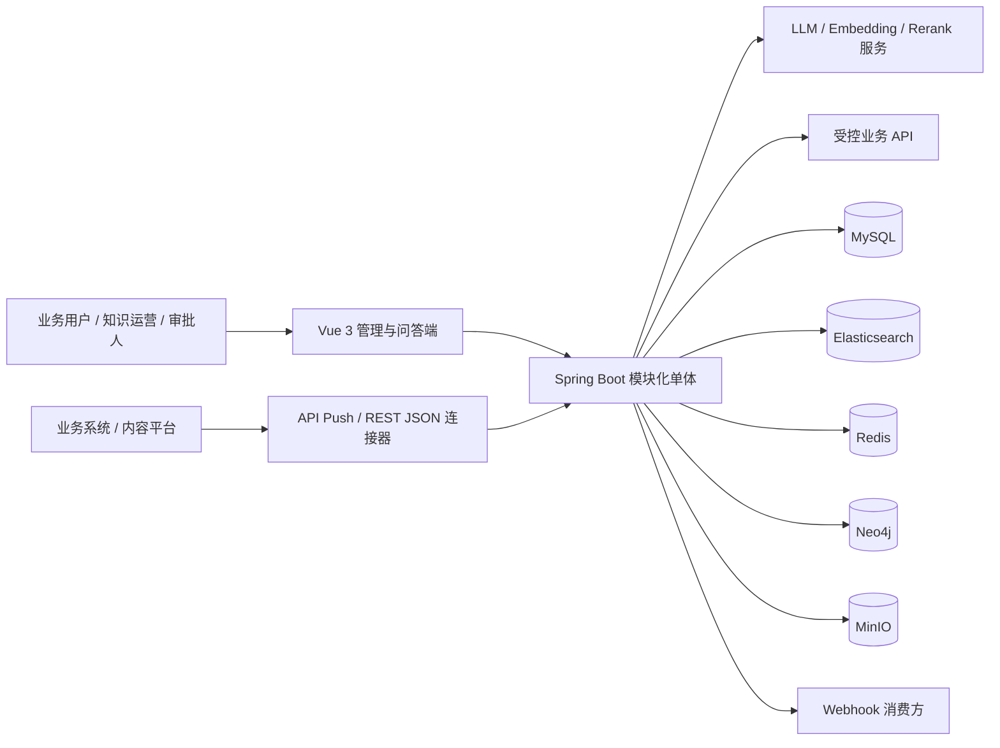
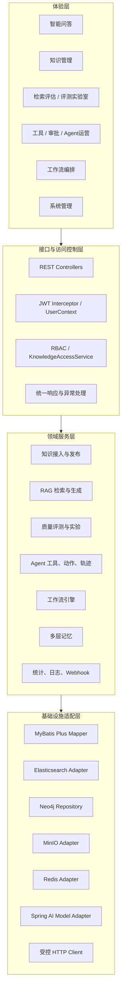
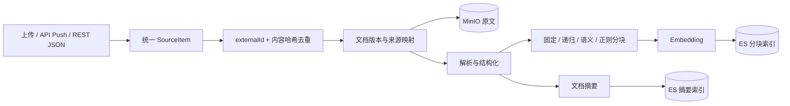
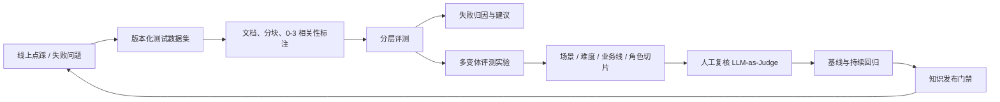
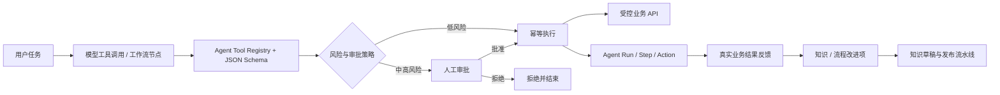
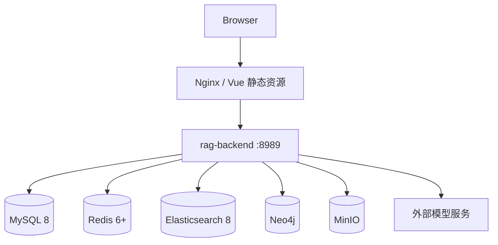

# SDH-RAG 平台架构与设计

> 文档状态：当前架构基线  
> 更新时间：2026-09-09
> 对应数据库版本：Flyway V27  
> 架构形态：Vue SPA + Spring Boot 模块化单体 + 多存储基础设施

## 1. 平台定位

SDH-RAG 已经从早期的“文档上传 + 知识问答”演进为企业知识与业务 Agent 平台。当前平台由三条相互闭环的主链路组成：

1. **知识生产与治理**：外部知识接入、去重与版本、审核发布、索引、回滚。
2. **RAG 问答与质量运营**：混合检索、回答生成、反馈回流、分层评测、实验和持续回归。
3. **Agent 执行与治理**：工具注册、模型选用、人工审批、幂等执行、轨迹审计和经验沉淀。

平台的核心价值不是单次问答，而是把“知识进入业务、业务产生反馈、反馈继续改善知识与 Agent”做成可管理、可评测、可审计的闭环。

## 2. 当前架构结论

| 维度 | 当前设计 |
|---|---|
| 应用形态 | 模块化单体，不是微服务；一个 Spring Boot 后端承载业务领域，一个 Vue SPA 提供管理与使用界面 |
| 接口形态 | REST API + 流式聊天响应，统一 `/api` 路径和 `Result<T>` 响应模型 |
| 权限模型 | JWT 身份认证、菜单 RBAC、知识库 owner/editor/reader 资源级权限 |
| 主数据 | MySQL 8，MyBatis Plus 访问，Flyway V1-V27 管理演进 |
| 文档与附件 | MinIO 保存原文件和发布生成的 Markdown 文件 |
| 检索 | Elasticsearch 同时承担文档分块向量、关键词、摘要粗排和语义记忆索引 |
| 图谱 | Neo4j 保存知识图谱和用户行为模式记忆 |
| 缓存与协调 | Redis 保存工作记忆、路由缓存、限流计数和知识源分布式锁 |
| 模型接入 | Spring AI，当前支持 DashScope/OpenAI 兼容模型、Embedding 与 Rerank 配置 |
| 异步执行 | MySQL 可靠 Job + 有界 Worker 池 + Spring Scheduler；评测与定时知识源同步已接入，其他异步链路逐步迁移 |
| 前端 | Vue 3、TypeScript、Vite、Ant Design Vue、Pinia、Vue Router、G6、Vue Flow |
| 部署 | Nginx 托管 SPA 并反向代理，后端独立容器；MySQL、Redis、Elasticsearch、Neo4j、MinIO 为外部依赖 |

## 3. 系统上下文



### 3.1 外部参与者

- **知识运营人员**：维护知识源、数据集、草稿、评测实验和质量问题。
- **普通业务用户**：进行知识问答，或在 Agent 模式下发起业务任务。
- **审批人**：处理高风险 Agent 动作，决定批准或拒绝。
- **业务系统**：向平台推送知识，或作为 Agent 受控工具的目标系统。
- **模型服务**：提供 Chat、Embedding、Rerank 和 LLM-as-Judge 能力。

### 3.2 系统边界

平台负责知识加工、检索、生成、评测、动作治理和审计；业务系统仍然是订单、库存、工单等交易数据的最终事实来源。Agent 工具调用不会把平台变成业务交易库。

## 4. 逻辑分层



### 4.1 分层规则

- Controller 只处理协议、参数和响应，不承载跨领域业务编排。
- Service 是事务、权限复核和业务状态流转的主要边界。
- Mapper/Repository 仅负责持久化，不能替代领域访问控制。
- 异步任务必须保存执行用户和资源 ID，执行时重新校验权限。
- 外部模型、存储和 HTTP 调用通过服务适配层隔离，避免控制器直接依赖 SDK。

## 5. 领域模块设计

### 5.1 身份、权限与协作

核心对象包括 `user`、`role`、`menu_permission`、`knowledge_base_member`。

- JWT 拦截器解析身份并写入线程级 `UserContext`。
- 菜单权限控制页面和功能入口。
- `KnowledgeAccessService` 统一判断 owner、editor、reader；后端资源权限是最终安全边界。
- 知识库列表、评测任务、发布草稿等对象都必须按可读知识库集合过滤，不能只依赖前端隐藏按钮。

### 5.2 知识接入与文档加工

知识来源分为三类：

- 用户上传 PDF、Word、TXT 等文件。
- 业务系统通过带 API Key 的 API Push 主动推送。
- `rest_json` 连接器按游标、分页和 Cron 从外部接口增量拉取。

统一加工链路：



关键设计：

- `knowledge_source_item` 用 `(source_id, external_id)` 保证来源幂等。
- 内容哈希避免无变化内容重复解析和向量化。
- 外部删除事件移除知识库关联和检索索引，但保留同步审计。
- 知识源调度使用 Redis 分布式锁与失败退避，避免多实例重复同步。
- 分块配置属于知识库与文档关系，支持不同知识库对同一文档使用不同加工策略。

### 5.3 知识审核与发布

业务经验和人工编辑内容先进入 `knowledge_draft`，不能直接写入线上检索索引。

状态机：

```text
DRAFT → IN_REVIEW → APPROVED → PUBLISHING → PUBLISHED
                ↘ REJECTED → DRAFT
PUBLISHING → PUBLISH_FAILED
PUBLISHED / PUBLISH_FAILED → ROLLED_BACK
```

发布流程包含：人工审核、生成 Markdown 文档、MinIO 持久化、文档关联、异步分块与索引、Top-5 回归问题门禁。门禁失败时状态为 `GATE_FAILED`，发布内容会从知识库关联和向量检索链路移除，同时保留原文档和发布审计。

### 5.4 RAG 检索与回答

当前检索不是单一向量 Top K，而是可配置的多阶段检索：


降级策略：摘要粗召回不可用时回退到全库混合检索；Rerank 或部分增强能力失败时保留基础召回结果。Metadata Filter 用于在检索阶段约束部门、产品、地区、文档日期等业务范围。

### 5.5 记忆系统

记忆按用途拆分，不把所有历史消息直接塞入 Prompt：

| 记忆层 | 当前存储 | 作用 |
|---|---|---|
| Working Memory | Redis | 当前会话短期上下文和窗口 |
| Episodic Memory | MySQL `chat_history` | 可追溯的历史问答与情景片段 |
| Semantic Memory | Elasticsearch `sdh-memory-index` | 用户事实和偏好的语义召回 |
| Abstract Memory | MySQL `memory_abstract` | 跨情景摘要和压缩信息 |
| Pattern Memory | Neo4j | 多次观察后形成的行为模式关系 |

`MemoryOrchestrator` 负责召回、组装、事实/偏好/模式提取和写回。记忆不可越过用户边界，也不应替代业务系统中的权威数据。

### 5.6 RAG 评测与质量运营

评测分为三个层级：

- `RETRIEVAL`：Recall@K、Precision@K、MRR、NDCG@K、MAP、负样本错误命中率。
- `GENERATION`：Context Precision/Recall、Faithfulness、Answer Relevancy、Completeness、Fluency。
- `FULL`：同一任务内完成检索与生成评测。

质量运营链路：



评测任务会保存数据集 ID、版本、配置快照和不可变 QA 副本。实验支持多个变体、Spring Cron、单批评审预算、失败重试和 Webhook 告警。人工评分归一化为 0-1，并统计各维度 MAE 和一档内一致率。

### 5.7 Agent 与工作流

平台提供两种执行模式：

- **Agent 模式**：模型根据工具描述和参数 Schema 自主选择工具，适合开放式业务任务。
- **工作流模式**：按 DAG 和节点配置确定性执行，适合稳定、可重复的流程。

两者复用同一套受控工具与动作治理：



安全边界包括固定 endpoint、HTTPS 默认、SSRF 防护、请求/响应大小限制、超时、禁止自动重定向、凭据环境变量引用和 `(tool_id, requested_by, idempotency_key)` 唯一约束。审批后的聊天或工作流从暂停点恢复，不重复已经执行的步骤。

### 5.8 平台运营

运营能力包括 Dashboard、热点词、Token 用量、问答评价、操作日志、公告、敏感词、模型配置、Prompt 模板、Webhook 和计划任务。Agent 运营页进一步统计任务完成率、工具成功率、审批状态、业务结果和改进项。

## 6. 数据架构

### 6.1 存储职责

| 存储 | 数据职责 | 一致性定位 |
|---|---|---|
| MySQL | 用户权限、知识库、文档元数据、会话、评测、实验、Agent、工作流和审计 | 业务事实来源 |
| MinIO | 上传原文、知识发布生成文件 | 大对象事实来源 |
| Elasticsearch | 分块全文与向量索引、文档摘要索引、语义记忆 | 可重建的查询模型 |
| Neo4j | 文档实体/概念/关键词关系、用户模式记忆 | 图查询模型 |
| Redis | 会话工作记忆、缓存、限流、调度锁 | 临时状态和协调设施 |

MySQL 与 MinIO 中的原始内容必须足以重建 Elasticsearch 和 Neo4j。搜索索引不应成为唯一事实来源。

### 6.2 关系数据领域分组

| 领域 | 主要表 |
|---|---|
| 身份与权限 | `user`、`role`、`user_role`、`menu_permission`、`role_menu`、`knowledge_base_member` |
| 知识与文档 | `knowledge_base`、`knowledge_document`、`knowledge_document_relation`、`document_hash`、`document_tag` |
| 外部知识源 | `knowledge_source`、`knowledge_source_item`、`knowledge_sync_task`、`knowledge_source_api_key`、`knowledge_source_api_audit` |
| 会话与反馈 | `chat_session`、`chat_history`、`qa_feedback`、`token_usage` |
| 评测 | `evaluation_task`、`evaluation_qa`、`test_dataset`、`test_dataset_item` |
| 可靠执行 | `platform_job`（幂等键、租约、心跳、重试、取消、死信和 Trace） |
| 评测实验 | `evaluation_experiment`、`evaluation_experiment_variant`、`evaluation_experiment_run`、`evaluation_experiment_run_task` |
| Agent | `agent_tool`、`agent_action`、`agent_action_feedback`、`agent_run`、`agent_step`、`agent_improvement_item` |
| 知识发布 | `knowledge_draft`、`knowledge_publish_record` |
| 工作流 | `workflow`、`workflow_node`、`workflow_execution` |
| 系统运营 | `operation_log`、`stats_daily`、`hotword_record`、`scheduled_task`、`webhook_config` 等 |

### 6.3 数据版本与审计原则

- Schema 只通过 Flyway 演进，禁止在生产环境手工修改后不回写迁移。
- 测试数据集使用递增版本，历史评测保存快照，不跟随数据集后续修改。
- 知识来源、发布、Agent 动作和评测实验均保留来源与运行记录。
- 重要状态变化应记录操作人、发生时间、结果和失败原因。
- 凭据表只保存哈希或引用，不保存可恢复的 API Key 明文。

## 7. 后端设计

### 7.1 包结构

```text
cn.sdh.backend
├── controller       HTTP 协议与资源入口
├── service          领域服务接口和部分领域编排
├── service.impl     服务实现与事务边界
├── entity / mapper  MySQL 实体与 MyBatis Plus Mapper
├── dto              API 与跨层数据对象
├── agent            Agent 规划、工具回调、审批路由、恢复状态
├── job              可靠任务处理器、调度器与执行上下文
├── workflow         DAG、节点执行器和工作流运行
├── knowledge        外部知识源连接器 SPI
├── memory           多层记忆与编排
├── graph            Neo4j 节点、仓储与抽取器
├── advisor          Spring AI Advisor
├── interceptor      JWT 与请求上下文
└── common / config  响应、异常、线程池和基础配置
```

### 7.2 事务与异步边界

- 评测业务记录和 `platform_job` 在同一事务写入，提交后由 Worker 通过数据库 CAS 抢占，不再依赖 JVM 提交回调。
- 定时知识源同步只由 Scheduler 发现并入队，实际拉取由可靠 Worker 执行。
- 知识发布在数据库提交后进行文档处理和索引。
- 可靠任务通过 `PENDING/RUNNING/RETRY_WAIT/SUCCEEDED/DEAD_LETTER/CANCEL_REQUESTED/CANCELLED` 暴露进度。
- `job_key` 唯一约束防止重复入队；租约、心跳和持有者条件更新防止迟到 Worker 覆盖结果。
- 文档处理、知识发布、Webhook、评测实验与部分 Agent 后台动作仍需迁移，并由 Outbox 补齐跨边界事件一致性。

### 7.3 API 设计

- 业务 API 统一使用 `/api/{domain}`。
- 普通管理接口返回 `Result<T>`；分页返回 records、total 等字段。
- 集成 API 使用 API Key，并返回真实 HTTP 401/403/429/5xx。
- 流式聊天单独维护流生命周期和错误事件。
- 导出接口直接返回文件流，不包装 JSON。

## 8. 前端信息架构

当前一级能力按用户任务组织：

| 工作区 | 页面 |
|---|---|
| 使用知识 | 智能问答、会话、语音问答 |
| 管理知识 | 知识库、文档、知识图谱、知识审核与发布 |
| 运营质量 | 检索评估、评测实验室、任务中心、问答评价、统计、热点词 |
| 执行业务 | 工作流编排、业务工具中心、Agent 审批与执行、Agent 运营与改进 |
| 配置平台 | 模型、Prompt、标签、敏感词、计划任务、Webhook、系统设置 |
| 管理组织 | 用户、角色、权限、操作日志、公告 |

前端使用路由懒加载；Pinia 保存身份、权限与全局 UI 状态；API 类型集中在 `src/api`。桌面侧边栏和移动菜单应共享同一份菜单元数据，这是后续需要收敛的设计债务。

## 9. 安全架构

### 9.1 已实现控制

- JWT 身份认证和后端资源级知识库权限。
- 用户、角色、菜单权限和操作日志。
- 模型、系统设置、计划任务、Webhook、用户、角色和操作日志接口执行后端管理员复核。
- 知识源 API Key 随机生成、摘要保存、独立限流和调用审计。
- 外部知识连接器、Agent HTTP 工具和 Webhook 的 HTTPS、SSRF、超时等网络边界。
- Agent 中高风险动作人工审批和幂等键。
- 敏感词、模型/Prompt 配置权限和发布审核门禁。
- 基础设施与 JWT 凭据通过环境变量注入；生产 Profile 对缺失、弱值和相同 JWT 密钥执行启动失败检查。
- 聊天、工作流、评测、路由和记忆日志默认不记录 Prompt、完整响应或 API Key 片段。

### 9.2 P0 第一轮完成状态

已完成：

1. 清除当前配置树中的已知可用默认密码、JWT 密钥和模型 Key，提供 `.env.example`。
2. 生产环境缺少必要 Secret、使用弱值或复用两个 JWT 密钥时启动失败。
3. 系统级管理接口增加数据库实时角色复核；Webhook 列表不再返回 Secret 和自定义 Header。
4. Webhook 默认只允许公网 HTTPS，并阻断回环、链路本地、组播和未授权内网地址。
5. 默认关闭 Prompt/响应正文日志，并移除若干直接输出模型、记忆和工作流内容的日志。

仍需完成：

1. 立即在实际基础设施和模型供应商侧轮换历史上已经暴露的凭据；代码无法代替外部密钥轮换。
2. 将环境变量适配升级为可插拔 Secret Provider，并对数据库中已有的模型 Key、连接器凭据和 Webhook Secret 加密或改存引用。
3. 建立正式租户模型后，为系统配置和 Webhook 增加 `tenant_id`；当前先按平台管理员隔离。
4. 对评测实验调度增加多实例租约，避免水平扩容后重复启动实验。
5. 在 CI 增加凭据扫描、Flyway 迁移集成测试和关键鉴权 API 测试。

## 10. 部署与运行架构

### 10.1 当前部署



`docker-compose.yml` 只编排前后端，基础数据服务当前由外部环境提供。后端 Actuator 仅暴露 health；前端容器通过 Nginx 提供静态文件与 API 代理。

### 10.2 扩展策略

- 前端可无状态水平扩展。
- 后端请求可无状态扩展；评测与定时知识同步已通过数据库租约安全竞争，尚未迁移的文档、Webhook 与实验调度仍限制多副本执行方式。
- Elasticsearch 索引按知识库过滤；大规模租户场景需要进一步评估共享索引、按租户索引或冷热分层。
- 文档处理、图谱构建、评测和 Agent 长任务达到一定量级后，可优先抽离为 Worker，而不是立刻拆分所有业务服务。

## 11. 可观测性与质量保障

### 11.1 当前能力

- Spring Boot Actuator 健康检查。
- 操作日志、API 调用日志、Token 用量、同步审计。
- Agent Run/Step/Action 轨迹。
- 知识发布记录与回归门禁结果。
- RAG 分层评测、实验批次、失败归因和人工复核。
- 后端单元测试与前端生产构建校验。

### 11.2 目标能力

- OpenTelemetry Trace 串联“HTTP → 检索 → 模型 → 工具 → 存储”。
- Micrometer/Prometheus 指标覆盖延迟、错误率、Token、模型成本、召回空结果、队列积压和调度延迟。
- 统一 `trace_id/run_id/task_id`，支持从用户投诉定位到检索结果、Prompt、工具调用和发布版本。
- 数据库迁移集成测试、真实 Elasticsearch 检索契约测试、外部连接器 Mock Server 测试。
- 前端关键闭环 E2E：知识发布、评测实验、Agent 审批与续跑。

## 12. 架构演进路线

本节给出架构级摘要；阶段排期、产品能力、验收指标与未来 90 天执行建议见 [平台升级方向与演进路线图](platform-evolution-roadmap.md)。

### P0：生产安全与配置治理

- 清理仓库中的明文凭据和弱默认值，轮换现有密钥。
- 按 dev/test/prod 分离配置，接入 Secret Manager。
- 明确 Webhook、模型配置和系统任务的管理员/租户边界。

### P1：可靠任务与可观测性

- 已建立统一 Job/Worker MVP：数据库原子抢占、租约、心跳、重试、取消和死信，首批覆盖评测与定时知识同步。
- 使用 Transactional Outbox 连接“事务提交”和“异步副作用”，覆盖索引、Webhook、评测和 Agent 恢复。
- 建立 OpenTelemetry、指标面板和成本预算告警。

### P2：质量与 Agent Evaluation

- 补齐任务完成率、工具选择准确率、参数正确率、无效调用率和安全策略命中率。
- Agent 失败轨迹一键转成回归场景，并进入实验与发布门禁。
- 支持成对评审、盲测和多评审模型校准，降低 LLM-as-Judge 偏差。

### P3：业务知识与场景闭环

- 从文档中心扩展到客户、产品、订单、工单、合同、政策和流程等业务对象。
- 为知识增加适用范围、生效时间、权威级别、责任人、血缘、冲突与健康度治理。
- 建设业务场景工作台，把知识、工具、审批、评测、版本和业务 KPI 统一配置。
- 让业务执行结果进入质量回流，形成“结果 → 失败样本 → 改进 → 门禁 → 发布”闭环。

### P4：平台化与边界清晰后的服务化

优先保持模块化单体。只有当团队、吞吐或故障隔离需求明确时，按以下自然边界抽离：

1. 文档加工与索引 Worker。
2. 评测与实验 Worker。
3. Agent 工具执行与审批服务。
4. 外部知识连接器运行时。

拆分前先建立领域事件、幂等协议、统一身份和可观测性，避免形成分布式单体。

## 13. 关键架构决策

| 决策 | 选择 | 原因 |
|---|---|---|
| 应用结构 | 模块化单体优先 | 当前领域仍在快速演进，保持事务与交付效率 |
| 检索存储 | Elasticsearch | 同时提供 BM25、向量 KNN、过滤和摘要索引 |
| 图谱存储 | Neo4j | 适合实体关系和模式记忆遍历 |
| 文档存储 | MinIO + MySQL 元数据 | 大对象与业务元数据职责分离 |
| 评测数据 | 版本化数据集 + 任务快照 | 保证历史结果可复现 |
| Agent 动作 | 工具注册 + 风险审批 + 幂等执行 | 让模型建议与真实副作用解耦 |
| 知识发布 | 草稿审核 + 索引 + 回归门禁 | 防止未经验证内容直接污染线上知识 |
| 服务拆分 | 按负载和故障边界渐进抽离 | 避免为“微服务”而微服务 |

## 14. 文档导航

- [产品设计文档](PRODUCT_DESIGN_DOCUMENT.md)：用户、功能与页面设计。
- [RAG 检索设计](rag-retrieval-design.md)：查询改写、混合检索、RRF 与 Rerank。
- [知识源连接器](knowledge-source-connectors.md)：API Push、API Key、REST JSON 与可靠调度。
- [知识发布流水线](knowledge-publishing-pipeline.md)：审核、索引、门禁和回滚。
- [分层 RAG 评测](layered-rag-evaluation-implementation.md)：指标、数据集、实验和人工校准。
- [RAG 质量路线图](rag-quality-operations-roadmap.md)：质量运营阶段与验收状态。
- [平台演进路线图](platform-evolution-roadmap.md)：升级优先级、阶段目标、验收标准和 90 天计划。
- [P0 安全加固指南](security-hardening-guide.md)：环境变量、历史凭据轮换、Webhook 网络策略和上线检查。
- [P1 可靠任务运行时](reliable-job-runtime.md)：状态机、租约、重试、取消、死信、API 与运行参数。
- [Agent 业务闭环](agent-business-loop.md)：工具、审批、轨迹、反馈和知识改进。

## 15. 代码导航

| 能力 | 主要入口 |
|---|---|
| RAG 检索 | `RagSearchServiceImpl`、`VectorStoreServiceImpl`、`SummaryIndexServiceImpl`、`RerankServiceImpl` |
| 问答与记忆 | `ChatServiceImpl`、`MemoryOrchestrator` |
| 知识源 | `KnowledgeSourceService`、`KnowledgeSourceSyncCoordinator`、`KnowledgeSourceConnectorRegistry` |
| 知识发布 | `KnowledgePublishingService`、`KnowledgePublishingController` |
| RAG 评测 | `EvaluationServiceImpl`、`EvaluationOperationsServiceImpl` |
| 评测实验 | `EvaluationExperimentServiceImpl`、`EvaluationExperimentController` |
| Agent | `AgentAskService`、`AgentToolService`、`AgentActionService`、`AgentOpsService` |
| 工作流 | `WorkflowEngine`、`WorkflowExecutionService` |
| 资源权限 | `KnowledgeAccessService`、JWT Interceptor、`UserContext` |
