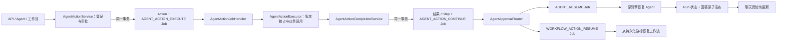
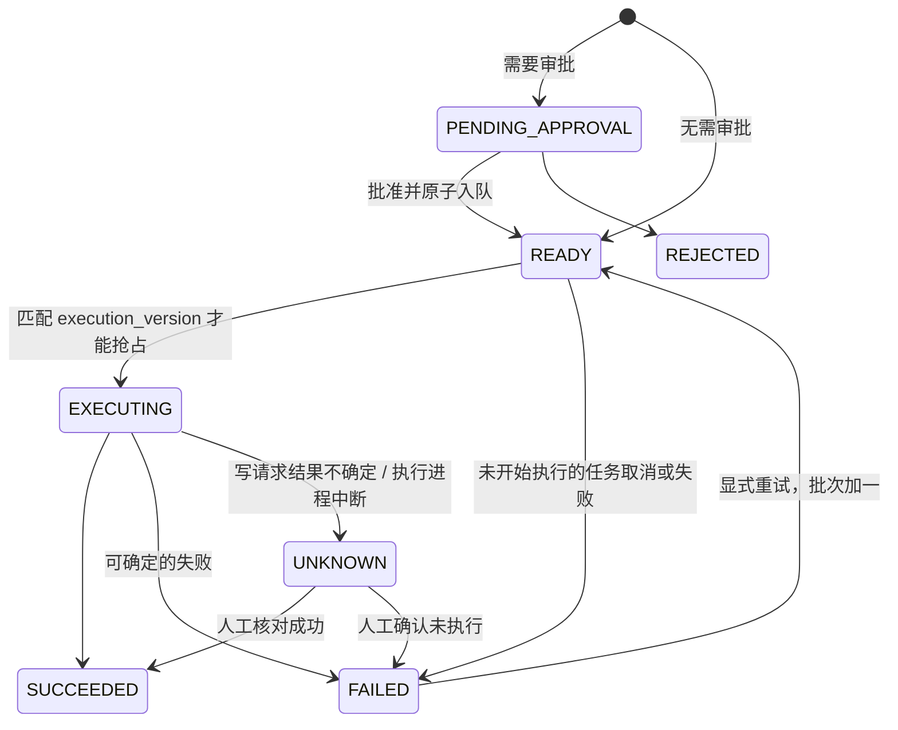

# 可靠 Agent 动作与后台续跑（V32）

实施日期：2026-11-03。承接 [AgentScope 架构方案](agentscope-2-architecture-upgrade.md) 与 [V31 实施记录](agentscope-runtime-implementation.md)。

## 本次升级的结果

业务写操作从 HTTP 审批请求中移出，改由持久化任务执行。动作登记/批准与执行任务在同一数据库事务提交；执行结果与后续通知也在同一事务提交。聊天和工作流使用同一动作状态语义，后台任务完成后，聊天页自动更新答案。

对于不需要审批的 GET 工具，保留现有同步查询方式。需要审批的工具在批准后统一入队。业务写请求返回 `READY` 表示已经受理，不表示下游已经执行成功。

## 运行链路与职责

主要职责：

| 组件 | 唯一职责 |
|---|---|
| `AgentActionService` | 身份、工具权限、动作参数、审批、核对与显式重试命令 |
| `AgentActionJobs` | 稳定任务键及动作与任务的版本绑定 |
| `AgentActionExecutor` | 仅在 READY 且批次匹配时抢占；执行工具；分类结果 |
| `AgentActionCompletionService` | 原子保存结果、更新步骤、投递后续通知 |
| `AgentActionState` | 统一哪些动作状态允许下游继续，未知状态默认阻断 |
| `AgentActionRecoveryScheduler` | 修复缺失执行任务；处理尚未发送就取消或死信的任务 |
| `WorkflowActionResumeJobHandler` | 在 Worker 内同步恢复工作流，替代后台线程启动后即视为完成 |
| `RunStateService.publish` | 原子提交 Run 状态与聊天回答，防止半完成状态可见 |

由于动作表和 `platform_job` 共用数据库，任务表本身就是事务交接载体。本轮复用该机制，没有复制 Webhook Outbox 成为第二套动作消息表。

## 动作状态与重试规则

- `execution_version` 从 1 开始；显式重试递增，创建新的执行任务键。
- 抢占和结果回写都校验批次。旧任务重放、旧 Worker 返回不能覆盖新批次。
- 对已经 EXECUTING、UNKNOWN 或已完成的动作，重复领取任务不会重新发送业务请求。
- UNKNOWN 不能直接重试。外部或内部写操作可能在抛出异常前已经产生副作用，必须核对。
- 任务中心显示的是 Worker 处理状态，业务动作状态仍以动作记录为准。例如 Worker 成功记录 UNKNOWN 时，任务可结束，但业务仍需核对。
- 等待恢复通知早于 Agent 挂起边界到达时，通知任务退避重试，不提前启动第二次运行。

新增任务类型：

| 类型 | 含义 |
|---|---|
| `AGENT_ACTION_EXECUTE` | 执行指定动作和批次 |
| `AGENT_ACTION_CONTINUE` | 消费已提交的动作结果 |
| `AGENT_RESUME` | 恢复原 Agent 引擎 |
| `WORKFLOW_ACTION_RESUME` | 恢复或终止等待动作结果的工作流 |

## 用户可见变化

1. 批准与重试按钮提示“已加入执行队列”，不再提前显示“已执行成功”。
2. Agent 新增 `WAITING_ACTION`，与 `WAITING_APPROVAL` 区分；待审批、待执行、执行中、待核对均有对应提示。
3. 聊天页对活跃后台 Run 进行轮询，完成后只合并对应消息的答案和轨迹，不覆盖其他会话。
4. 轮询使用递增代次和会话身份检查，丢弃切换会话前发出的旧响应；错误时退避，权限失效/不存在时停止该 Run 的轮询。
5. 后台轮询的短暂故障不重复弹出错误通知；手动操作的错误仍正常提示。
6. 暂停状态和占位回答持久化，刷新页面仍可找到待处理运行；完成状态和最终答案在同一事务发布。
7. 工作流的失败、拒绝、待核对动作不能启动下游节点；手动恢复入口也执行相同校验。
8. 任务中心可按新增 Agent / 工作流任务类型筛选。

工作流现有等待状态仍使用 `WAITING_APPROVAL` 作为兼容的暂停状态，节点输出中的 `actionStatus` 区分具体等待原因；没有在本轮重写整套工作流状态模型。

## 兼容与迁移

先通过正常 Flyway 流程执行至 **V32**，再部署后端与配套前端。V32 增加：

- `agent_action.execution_version`
- `agent_action.execution_job_id`
- `agent_action.started_at`
- 任务关联与恢复查询索引

注意以下行为契约：

- API 路径与请求格式保持兼容，但写操作请求或批准后的即时状态可以是 READY；调用方应查询结果，不能假定响应代表业务完成。
- 聊天旧 `X-Agent-Resume: skip` 请求头仍可发送，但当前后端通过持久化结果通知控制恢复，不用它关闭后台执行。
- 恢复按 Run 记录的引擎执行；`AGENT_RUNTIME` 仍控制新 Agent Run 的引擎选择。可靠动作队列同时适用于 legacy 和 agentscope。
- SDK 工具幂等键采用递归排序的参数结构，并固定长度；同一 Run 下同工具同参数仍复用一个操作。对于旧 SDK 键格式，优先查找原动作并沿用原身份，避免恢复时再次创建。
- 历史 READY 动作可由扫描器补建任务；历史 EXECUTING 中断动作保守进入 UNKNOWN，不能据此自动重发。

回滚时必须保留能够处理新任务类型的兼容 Worker，先排空动作与续跑任务，再考虑降级旧应用。直接用只支持同步动作的旧后端接管活跃队列，可能破坏执行所有权。数据库新增列和索引保留，不做自动回删。

## 验证

| 检查 | 结果 |
|---|---|
| 写请求不在请求线程调用业务系统 | 先复现失败，再通过入队实现修复 |
| Spring + MyBatis + H2 真实事务 | 验证登记/任务、批准/任务、结果/通知、Run/回答的原子性与回滚 |
| 显式重试 | 新批次绑定新任务；旧批次不能抢占或覆盖 |
| 重复与不确定执行 | EXECUTING、UNKNOWN 和已完成动作不重复发请求 |
| 取消与恢复 | 未发送的取消任务转可见失败；UNKNOWN 禁止直接重试 |
| 旧格式幂等键 | 恢复复用已有动作及任务 |
| 工作流边界 | 未决、失败、拒绝均不能通过恢复接口执行下游 |
| 后端全量测试及打包 | 121 项，0 失败、0 错误；1 项环境集成测试按配置跳过 |
| 前端行为测试 | 4 项通过，覆盖保留流式内容、后台完成、跨 Run 响应、审批状态与失败展示 |
| 前端生产构建 | 通过；仍有既有大分包提示 |
| 全局类型检查 | 仍为原有 320 条诊断；与隔离基线比较，忽略行号后无新增或改变的诊断 |

后端执行了 `mvn -pl rag-backend -am package`；前端执行了 `npm run test:unit`、`npm run build`、`npx vue-tsc --noEmit`。日志在 `.workbuddy/agent-action-*.log`。没有对实际 MySQL 执行迁移，也未部署生产或调用真实模型。

## 剩余边界

本轮没有宣称跨系统“恰好一次”。下游成功但平台结果提交失败时，保守保留不确定状态；仍需下游幂等/查询接口或人工核对。

后续 [V33 执行租约与中断识别](agent-run-execution-lease.md) 已补充单个 Run 的执行批次、写入隔离和中断状态。RUNNING 状态进程被强杀后的完整自动接管、SSE 事件游标回放、Agent Eval、成本预算与记忆删除代际控制仍属于后续实施范围。当前自动恢复聚焦于已持久化的动作与挂起边界，不能恢复任意模型调用的任意中间帧。

## 本轮行动记录

| 行动 | 原因 |
|---|---|
| 检查已有实现与工作区 | 沿用既有未提交工作，不重建第二套任务系统 |
| 添加写请求回归测试并确认失败 | 证明原请求会同步触发业务写入 |
| 拆分命令、执行、完成与任务边界 | 将网络副作用移出写入受理事务，明确唯一执行者 |
| 使用真实 SQL 事务测试 | 验证队列异常时没有半提交动作或半完成回答 |
| 加入执行批次、版本抢占与状态条件回写 | 防止重复领取和旧 Worker 覆盖新尝试 |
| 统一阻断状态与工作流校验 | 避免不同入口对 UNKNOWN 或失败动作作不同决定 |
| 改造挂起持久化、聊天恢复与轮询 | 让后台执行完成后用户能看到真实结果 |
| 修复嵌套参数排序及长度边界 | 防止参数顺序变化绕过去重，同时兼容旧操作身份 |
| 全量测试、构建、类型基线对比 | 形成可检查的交付结果，并明确已有类型问题 |

本轮未提交、推送或清理原有工作区。临时类型基线沿用上一轮产物，没有再次执行被拒绝的目录清理操作。
