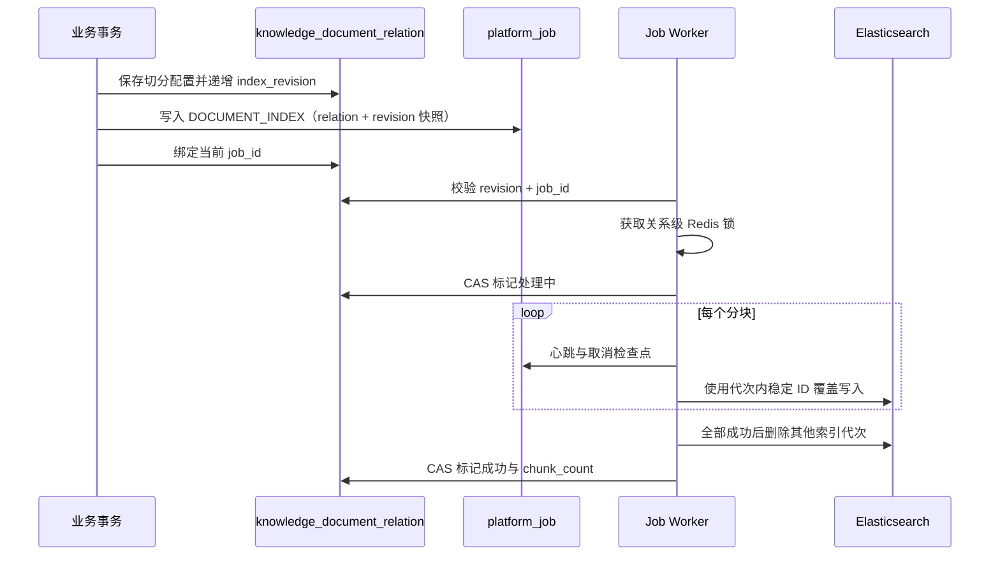

# 可靠文档解析与索引

> 状态：P1 第三批已落地
> 更新日期：2026-09-14
> 数据库迁移：`V30__reliable_document_indexing.sql`

## 1. 解决的问题

旧流程使用 JVM `@Async` 直接解析文件并写 Elasticsearch，应用重启后任务会丢失；异常被内部捕获后，统一运行时无法重试。重新处理还会先删除旧向量，解析或模型短暂失败会让原有知识立即不可用。

本阶段将关联、重新处理、知识源同步和知识发布共用的文档入口收口到 `DOCUMENT_INDEX` 可靠任务，保留原有业务接口与处理状态。

## 2. 执行协议

关键语义：

- 任务键为 `document-index:{relationId}:v{revision}`，同一版本重复入队只产生一个 Job。
- payload 保存文档、知识库、关系版本和完整切分配置快照，重启后不依赖内存参数。
- `index_revision + job_id` 是业务侧 fencing token；迟到或被替代的 Worker 无法回写当前状态。
- Redis 锁保证同一知识关系只有一个 Elasticsearch 写入者，取消关联也使用同一把锁。
- 向量 ID 由 `knowledgeId:documentId:chunkIndex:indexRevision` 确定生成，同一代次重试覆盖同一分块，不制造重复向量。
- 新代次分块全部写入成功后才删除旧代次（也会清理历史随机 ID 向量），避免重新处理开始时出现整篇知识空窗。
- 任一向量写入返回失败都使 Job 失败并进入指数退避；不再把“部分成功”标记成索引成功。
- 任务取消或最终重试耗尽时清理未完成代次，保留上一完整代次。
- 解析 MinIO 文件失败会抛给任务运行时，而不是误判为内容为空并清空索引。

## 3. 状态与恢复

`knowledge_document_relation.process_status` 保持兼容：`0` 待处理、`1` 处理中、`2` 成功、`3` 失败。新增字段：

| 字段 | 用途 |
|---|---|
| `index_revision` | 每次入队递增的索引代次，用于隔离迟到任务 |
| `job_id` | 当前代次对应的可靠任务，可从任务中心追踪 |

应用每分钟扫描 `process_status=0 AND job_id IS NULL` 的遗留或异常待处理关系，并重新建立版本化任务。正常入队时关系更新、Job 创建和任务绑定在同一数据库事务内完成。

任务在解析前和每个分块前执行心跳/取消检查点。失败会同时写入关系错误信息和 Job 重试状态；达到最大尝试次数后进入死信，可在任务中心人工重放。

## 4. 运维与后续

- `knowledge.documents.index-lock-minutes` 默认 120 分钟，应大于单篇最大索引耗时。
- 文档任务最多尝试 10 次，避免新版本因等待旧版本锁而过早进入死信。
- 任务中心支持按“文档解析与索引”筛选，并展示 Trace、尝试次数和错误摘要。
- 下一步应让检索查询只读取关系表标记的 active revision，或升级为 Elasticsearch alias 原子切换；当前写入期间新旧代次会短暂并存，但失败/取消不会删除上一完整代次。
