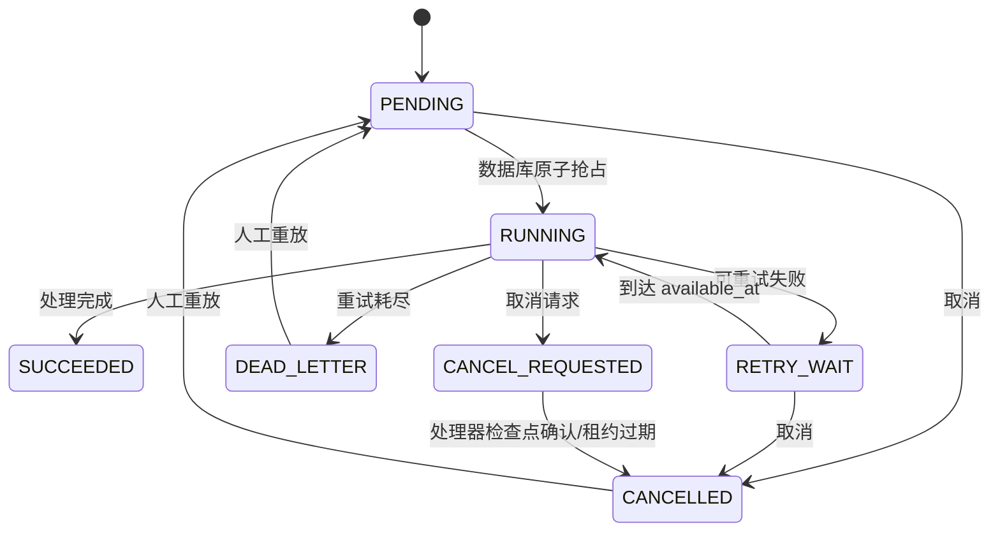

# 可靠任务运行时

> 状态：P1 第二批已落地
> 更新日期：2026-09-14
> 数据库迁移：`V28__platform_job_runtime.sql`、`V29__transactional_outbox_webhook_delivery.sql`、`V30__reliable_document_indexing.sql`

## 1. 目标与当前范围

可靠任务运行时把原先只存在于 JVM 线程池中的后台工作保存到 MySQL，使任务在应用重启、工作节点异常或短暂依赖故障后仍可恢复。目前已接入：

- RAG 自动生成评测、导入数据集评测、内置/版本化数据集评测。
- REST JSON 知识源的定时拉取同步。
- 评测回归与失败事件的 Transactional Outbox 和 Webhook 可靠投递。
- 文档解析、切分、向量索引、重新处理与遗留待处理关系恢复。

手动知识源拉取仍保持同步 API，评测实验编排和 Agent 动作将在后续批次迁移。

## 2. 状态机

核心语义：

- `job_key` 是业务幂等键并有唯一索引，相同业务任务只会入队一次。
- Worker 通过带状态条件的 SQL CAS 抢占，不依赖单机内存锁。
- `lease_owner/lease_until/heartbeat_at` 记录租约；节点消失后，其他节点可接管过期任务。
- 每次失败按指数退避进入 `RETRY_WAIT`，重试耗尽进入 `DEAD_LETTER`。
- 长任务在样本边界调用检查点，续租并响应取消。
- 只有持有当前租约的 Worker 能回写成功或失败，迟到 Worker 无法覆盖新执行结果。

## 3. 评测任务一致性

创建 `evaluation_task` 和写入 `platform_job` 在同一个数据库事务内完成，避免出现“业务任务已创建但进程在提交线程池前退出”的窗口。评测 Job 的 payload 保存任务模式和不可变数据集副本，重启后不依赖 JVM 闭包。

重试开始时会清理该任务上一次未完成的 QA 结果，再重新执行，因此不会重复累计样本。评测页面支持排队/运行任务取消，以及失败、死信或已取消任务重放。

## 4. 知识源同步一致性

定时调度器只负责发现到期知识源并写入 Job。幂等键由 `source_id + next_sync_time` 组成，多实例同时扫描时唯一索引会收敛为同一任务。业务侧仍使用 Redis 锁避免手动拉取和定时拉取并发；内容写入继续通过 `external_id + content_hash` 去重。

知识源服务自身已经维护失败退避时间，因此同步 Job 当前只尝试一次，避免 Job 重试与知识源退避形成两套重试循环。

## 5. API 与界面

- `GET /api/jobs`：查询当前用户创建的任务，可按状态和类型筛选。
- `GET /api/jobs/{id}`：查看任务状态、Trace ID、尝试次数与错误摘要，不返回 payload。
- `POST /api/jobs/{id}/cancel`：取消排队任务或请求运行中任务协作取消。
- `POST /api/jobs/{id}/replay`：重放失败、死信或已取消任务。
- `POST /api/evaluation/task/{id}/cancel`：从评测业务页取消并同步业务状态。
- `POST /api/evaluation/task/{id}/replay`：从评测业务页重新执行。
- `GET /api/admin/reliable-execution/metrics`：管理员查看全局积压、重试、成功率、死信和活动告警。

前端“知识管理 → 任务中心”每 5 秒刷新一次，普通用户仅显示自己的任务；管理员额外看到全局可靠执行指标和活动告警。Job payload 不通过接口或页面暴露，避免测试数据和连接器配置泄漏。

文档任务类型为 `DOCUMENT_INDEX`。每次处理都会推进 `knowledge_document_relation.index_revision`，并将当前 `job_id` 与该版本绑定；旧版本 Worker 只能安全跳过，不能覆盖新任务状态。详细协议见 [可靠文档解析与索引](reliable-document-indexing.md)。

## 6. 运行参数

| 环境变量 | 默认值 | 说明 |
|---|---:|---|
| `JOB_DISPATCH_DELAY_MS` | 2000 | 数据库扫描间隔（毫秒） |
| `JOB_DISPATCH_BATCH_SIZE` | 10 | 单轮最大抢占数，实际还受空闲 Worker 数限制 |
| `JOB_LEASE_SECONDS` | 600 | 租约时长；每个业务检查点会续租 |
| `KNOWLEDGE_DOCUMENT_INDEX_LOCK_MINUTES` | 120 | 单个知识关系的索引互斥锁 TTL（分钟） |
| `KNOWLEDGE_DOCUMENT_RECOVERY_DELAY_MS` | 60000 | 无任务待处理关系的恢复扫描间隔（毫秒） |

生产环境应让租约时间大于单个不可中断外部调用的最大超时，并把数据库时间统一为同一时区。

## 7. 下一批建设

1. 将评测实验编排和 Agent 外部动作接入 Job，并为每类副作用定义明确幂等键。
2. 从统一关联 Trace ID 继续升级为检索、模型、工具和 Agent 步骤级 OpenTelemetry Span。
3. 增加 P50/P95 执行延迟、处理耗时、模型 Token 与成本预算指标。
4. 将活动告警接入企业通知通道，增加抑制、合并、责任人路由和恢复通知。
5. 增加管理员全局任务列表、Outbox/投递历史、按租户隔离以及死信处置审计。
